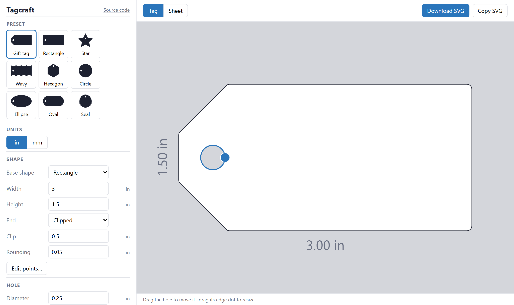
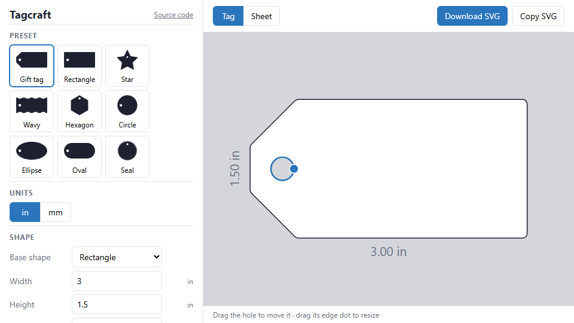
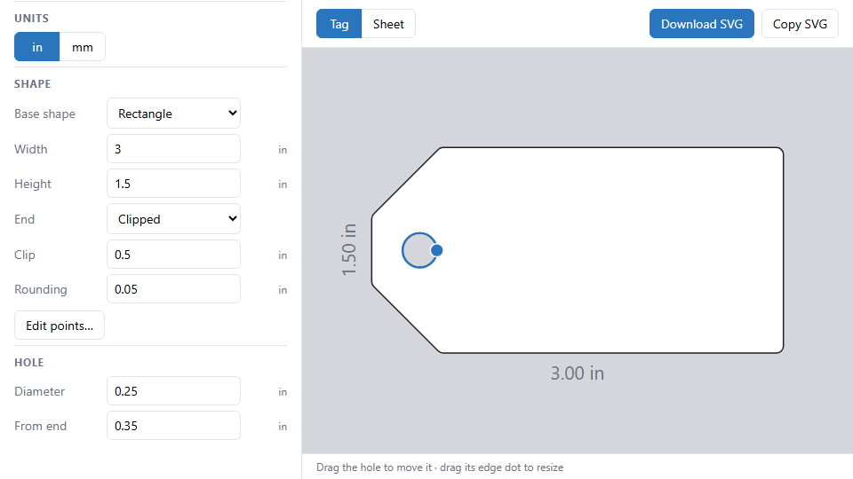
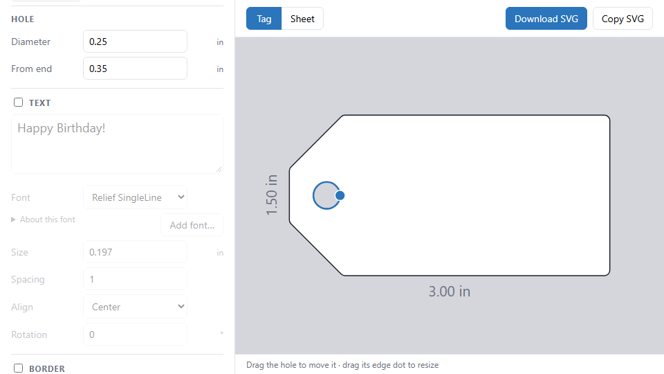
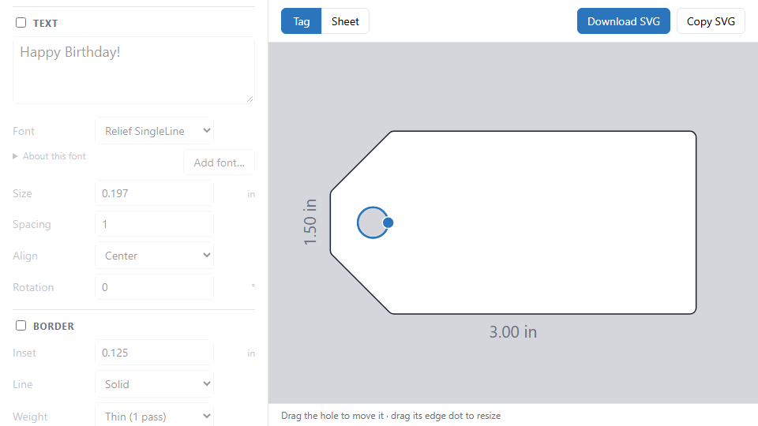

# Using Tagcraft

A walkthrough of the app, from picking a tag to downloading a file you can cut. Try it at **[footgunz.github.io/tagcraft](https://footgunz.github.io/tagcraft/)**.

Once your SVG is ready, see [Cutting with Cricut Design Space](cricut.md).

The left panel is the controls; the right side is a live preview with the tag's width and height labelled. Your current design is remembered in your browser between visits.

## 1. Pick a preset

**Preset** is a grid of thumbnails. Click one to load it. Your own saved designs appear after the built-in ones (see [Save your design](#8-save-your-design)).

| Preset | What it is |
| --- | --- |
| Gift tag | 3" × 1.5" rectangle with the two corners at the hole end clipped at 45° (0.5" clip), lightly rounded corners and a 0.25" hole. The starting point. |
| Rectangle | Square-ended rectangle |
| Star | 5-point star |
| Wavy | Rectangle with wavy long edges |
| Hexagon | Six-sided polygon |
| Circle | Ellipse with proportions locked, 2" across |
| Ellipse | 3" × 1.75" ellipse |
| Oval | 3" × 1.5" stadium: straight long sides, fully round ends |
| Seal | 36 shallow points, 2.5" across, like a certificate seal |

## 2. Units

The **Units** switch picks inches or mm for every length in the panel, the preview labels and the exported file. Switching never changes the design, only how it is shown.

## 3. Shape it

Choose a **Base shape**, then set **Width** and **Height**.

Each shape has its own extra settings:

| Base shape | Settings |
| --- | --- |
| Rectangle | **End** (Square, Clipped or Rounded; Rounded is a full semicircle across the height), **Clip** (when Clipped), **Rounding** for the corners |
| Polygon | **Sides**, **Rounding**, **Lock proportions** |
| Star | **Points** (up to 60), **Depth** (inner radius as a fraction of the outer; higher is shallower), **Rounding**, **Lock proportions** |
| Wavy | **End**, **Clip**, **Waves** and **Wave height** along the long edges (the short ends stay straight) |
| Ellipse | **Lock proportions** (on, it is a circle) |
| Oval | Width and height only |

Switching base shape keeps your size and hole and takes that shape's other settings from its preset. **Lock proportions** keeps polygons, stars and ellipses regular: changing width changes height to match, and the other way round. Turn it off to stretch them. Polygons and stars always point up, and rounding is applied after stretching so corners stay circular.

The hole end is the left end for horizontal shapes (rectangle, wavy, ellipse, oval) and the top for polygons and stars.

## 4. Place the hole

The hole is always round and centered across the tag. In **Hole**, set its **Diameter** and its distance from the hole end (**From end**, or **From top** for polygons and stars). The distance runs from the outermost point of the hole end, such as the clipped tip, to the center of the hole.

You can also do it on the preview:

- **Drag the hole** to slide it along the tag's axis.
- **Drag the dot on its edge** to resize it.

The fields and the preview stay in sync as you drag.

**Minimum wall.** At least 1/8" (3.175 mm) of material always stays around the hole. The hole can't be dragged or sized past that, and if a typed value or a shape change (a smaller height, more sides, deeper star points) would break it, the hole is moved first and then shrunk, and the status line says **Hole adjusted to keep a 1/8" wall**.

## 5. Edit points

For a shape no setting can make, press **Edit points…**. The outline (not the hole) becomes bezier points: drag a square point to move it, and drag its round handles to bend the curves. Press **Done editing** when you're finished.

- Once a design has edited points, the shape settings are disabled for it. **Width** and **Height** still scale the edited shape, and the hole stays editable.
- **Reset to shape** throws the point edits away and goes back to the shape settings.
- The hole stays on the centerline of the edited outline's bounding box and slides along it as before. Moving or resizing the hole, or changing **Width** or **Height**, still keeps the 1/8" wall.
- Point edits are never blocked. If dragging a point brings the outline closer than 1/8" to the hole, or across it, the hole stays where it is, the status line shows a warning and the hole is highlighted. You can still save and export, so check the preview before you cut.

## 6. Add text

Turn on **Text** (the checkbox in its heading) to write on the tag. Text is drawn with your cutter's pen, not cut out, and it repeats on every tag of a sheet.

- **Text**: type in the box; Enter starts a new line. The preview updates as you type.
- **Font**: the list starts with **single-line fonts (for pens)**: the pen traces each letter once, which is quick and clean. Fonts you add are listed after them; ordinary TTF, OTF or WOFF fonts are marked **(outline)**, because a pen draws the outline of each letter and the letters come out hollow. **About this font** says which kind a font is and shows its license.
- **Add font…** uses a font file for this visit only: `.ttf`, `.otf`, `.woff`, or a single-line `.svg` font. A design that names a font the app doesn't have uses Relief SingleLine instead, and the status line says so.
- **Size** is the height of a capital letter, so a size of 1/4" gives capitals 1/4" tall.
- **Spacing** is the space between lines, as a multiple of the font's normal line height.
- **Align** lines left, center or right in the box.
- **Rotation** turns the text, in degrees.

One font, size, spacing and alignment applies to all the text on the tag.

**The text box.** Text sits in a box with a dashed border on the preview; the border is never cut or drawn. A new box starts beside the hole (or below it on polygons and stars).

- **Drag inside the box** to move it, and **drag its square handles** to resize it.
- **Drag the dot above the box** to turn it. It snaps to 45° steps when you get close, and to 15° steps while you hold Shift.
- Words wrap at the box's width. **Anything that doesn't fit in the box is cut off at its edge**, so text never spills outside it: make the box bigger, the text smaller, or the text shorter to show it all.
- The box always stays on the tag. Turning a box that wouldn't fit shrinks it until it does.
- Text never runs into the hole: where the box reaches over it, the text there is left out, with a small gap around the hole, and the status line says so.

## 7. Add a deboss border

Turn on **Border** to add a line around the tag, just inside its edge, for a debossing tool (or a scoring tool or pen). It follows the shape, including edited points, and stops short of the hole so it never runs into it.

| Setting | What it does |
| --- | --- |
| **Inset** | How far in from the edge the border runs. Default 1/8". |
| **Line** | **Solid**; **Dashed**; **Dotted** (short dots, like stitching); or **Double**, two lines with a gap between them. Dashes and dots are separate strokes, so the tool lifts between them. |
| **Weight** | **Thin**, **Medium** or **Bold**: one, two or three passes side by side. A debossing tip has one width, so more passes make a wider line. |

If the inset is too big for the shape, there's no room for a border: the status line says so and no border is exported.

## 8. Save your design

The **Save** section appears once you change anything about a built-in preset; an untouched preset is already in the grid. Type a **Name** and press **Save design** (or Enter). It is stored in your browser and shows up in the preset grid after the built-ins, with its own thumbnail. Saving a name you already used replaces that design. You can't reuse a built-in preset's name.

To delete one, click the **×** on its thumbnail; it turns into **Remove?**, and a second click within a few seconds removes it. Built-in presets can't be removed.

If your browser has storage turned off, Save is disabled and the status line says so. Everything else still works. Saved designs live in that one browser; export the SVG if you need the tag elsewhere.

## 9. Export

**Download SVG** saves `tagcraft-<design name>.svg`; **Copy SVG** puts the SVG text on the clipboard. The file holds one tag at true size: `width` and `height` are in the display unit you chose (in or mm), with a `viewBox` in mm.

The file has up to three Inkscape layers, one for each tool:

| Layer | What's in it | Tool |
| --- | --- | --- |
| **Tag** | The tag: a single path, outline plus hole, with the hole cut out of it, drawn with real curves | Blade (cut) |
| **Text** | The text, as blue lines (no fill) | Pen |
| **Border** | The deboss border, as red lines (no fill) | Deboss, score or pen |

The Text and Border layers are left out when they're turned off. The text box's dashed border is never in the file.

To export a whole sheet of copies instead, see [Fill a sheet](#10-fill-a-sheet).

## 10. Fill a sheet

To cut many copies of a tag at once, switch the toolbar from **Tag** to **Sheet**. The preview then shows a whole sheet of paper with as many copies of your tag as fit. The dashed line is the margin. Sheet view is for looking only; switch back to **Tag** (or press **Edit points…**) to change the tag. Any change you make to the tag or the sheet shows up on the sheet straight away.

Set up the paper in the panel's **Sheet** section, which appears while you're in Sheet view:

| Setting | What it does |
| --- | --- |
| **Size** | **Letter** (8.5" × 11"), **A4** (210 × 297 mm), or **Custom**, with your own **Width** and **Height**, for a partial sheet, a scrap or an odd paper size (up to 12" × 24"). |
| **Margin** | Space kept clear around the edges of the sheet. Default 1/4". |
| **Gap** | Space between neighbouring tags. Default 1/8". |
| **Count** | Leave it empty for as many as fit (the field shows how many that is), or type a smaller number to cut only that many. To go back to as many as fit, press **All** next to the field, step the number down below 1, or clear it. |

The line under the settings says how many tags fit and how they sit (upright, turned on their side, or flipped upside down), for example **15 tags fit · 15 turned**, or **Cutting 4 of 15** when you set a count.

How the tags are laid out:

- Tags are turned 90° when that fits more. The gift tag fits 12 upright on Letter but 15 turned. Sometimes a mix of upright and turned tags fits best.
- Tags are packed from the top-left corner, so the paper you don't use stays in one piece you can use again as a partial sheet. With a count, the first tags in reading order are kept.
- Shapes nest when that fits more: rows are staggered so circles and hexagons sit in the gaps of the row above, and stars and triangles are turned alternate ways so their points interlock. A 1" star fits 83 to a Letter sheet this way, against 63 in a plain grid. Tags always stay at least the gap apart, measured between their actual outlines.

In Sheet view the toolbar buttons export the sheet: **Download sheet SVG** saves a file named for the design, sheet and count, such as `tagcraft-gift-tag-letter-15up.svg`, and **Copy sheet SVG** copies it. The SVG is the sheet at true size with each tag as its own path, hole cut out. Text and the border come along on every tag, turned with it, in their own Text and Border layers. There's no sheet outline in the file, so nothing extra gets cut. If the tag doesn't fit on the sheet at all, even turned, the summary says so and the buttons are disabled.

Your sheet settings are remembered in your browser, separately from your designs. To cut a sheet on a Cricut, see [Cutting a sheet of tags](cricut.md#cutting-a-sheet-of-tags).

Not yet available: PNG export.
